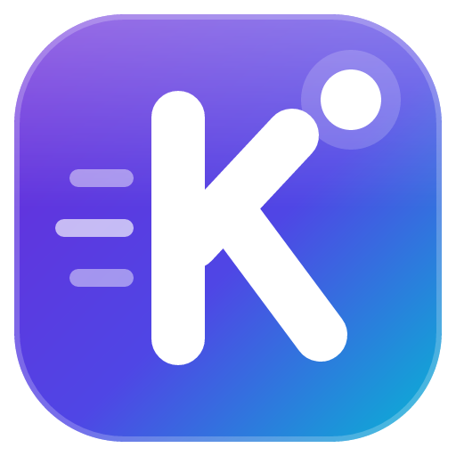

<p align="center">
  
</p>

<h1 align="center">Kinetix</h1>

<p align="center">
  Lightweight native desktop widgets for Windows laptops: App Dock, Clock,
  Calendar, YouTube Music, Sticky Notes and Control Center.<br>
  Bộ widget desktop cho Windows, nhẹ, mượt, tiết kiệm RAM và pin cho laptop.
</p>

---

## Tiếng Việt

**Kinetix** là bộ widget desktop chạy native bằng Rust (không Electron, không WebView),
được tối ưu cho laptop:

- **Tự bật chế độ tiết kiệm khi dùng pin** hoặc khi bật Battery Saver: giảm tốc độ
  khung hình animation, giảm hiệu ứng blur, thu nhỏ cache và trả RAM thừa cho Windows.
  Cắm sạc lại thì tự về chế độ đầy đủ. (General Settings › *Auto low-power on battery*)
- **Widget Music nhẹ hơn**: trình duyệt ẩn tắt các dịch vụ nền không dùng tới và được
  phép giảm tải khi đang tiết kiệm pin.
- **An toàn hơn**: không mở trình duyệt khi ứng dụng đang chạy quyền Administrator;
  bộ cập nhật kiểm tra SHA-256, chỉ tải từ GitHub qua HTTPS, có rollback.

**Cài đặt:** tải `Kinetix-<phiên bản>-windows-x86_64.zip` ở mục
[Releases](https://github.com/hpb282/Kinetix/releases), giải nén **toàn bộ** vào một
thư mục bạn có quyền ghi (ví dụ Downloads, không dùng Program Files) rồi mở
**Kinetix.exe**. Không cần cài Python, Node hay Rust. Widget Music cần Chrome hoặc
Edge và kết nối Internet.

File exe chưa được ký số nên Windows SmartScreen có thể cảnh báo "Unknown publisher";
chọn *More info › Run anyway* nếu bạn tải từ trang Releases của repo này.

Chi tiết rà soát bảo mật và tối ưu: [docs/laptop-optimization-vi.md](docs/laptop-optimization-vi.md).

## English

### Download

Get `Kinetix-<version>-windows-x86_64.zip` from
[Releases](https://github.com/hpb282/Kinetix/releases), extract the whole archive
to a writable folder (not Program Files) and run **Kinetix.exe**. No Python, Node,
Rust or Visual Studio install is needed. Music playback uses an installed Chrome
or Edge and an internet connection; other widgets need no browser.

Target: Windows 10/11 x64. The binary is not code-signed. Data is stored in
`config/` next to the executable. *Start with Windows* is on by default and can
be turned off in General Settings.

### Highlights

- **Laptop-first power management** — automatic low-power mode on battery or
  Battery Saver (lower animation frame rate, lighter blur, smaller caches, memory
  returned to Windows), restored automatically when plugged in.
- **Native and light** — one Rust/Win32 process with a shared wallpaper
  compositor; no Electron or WebView.
- **Widgets** — App Dock, Clock, Calendar, YouTube Music, Sticky Notes and
  Control Center, each with its own on/off switch and settings. Widgets snap and
  fuse together, rescale live on DPI changes and can be duplicated across monitors.
- **Safe updates** — General Settings › Updates checks this repository's
  releases over HTTPS, verifies SHA-256 digests for the archive and every file,
  keeps backups in `config/updates/` and rolls back on failure.

### Build from source

Prerequisites: Rust (MSVC toolchain), Visual Studio C++ Build Tools, and
Python 3.10+ for the safety check and packaging scripts.

```text
python scripts/check_safe.py
cargo build --release --locked --manifest-path native-dock/Cargo.toml
.\native-dock\target\release\kinetix.exe
```

Stop any running `kinetix.exe` before rebuilding. Portable ZIPs are produced by
`python scripts/build-portable.py` under `share/`. Pushing a `v*` tag runs the
GitHub Actions workflow that tests, packages and publishes a release.

### Checks

```text
python scripts/check_safe.py
python -m unittest discover -s scripts -p "test_check_safe.py"
python -m unittest test_startup_windows
cargo test --locked --manifest-path native-dock/Cargo.toml -- --test-threads=1
```

Widget packages live in `widgets/<id>/native/`; see
[package development](widgets/README.md) and [Music](docs/youtube-music.md).

## Credits and license

**Kinetix** by **hpb282** — MIT License, see [LICENSE.txt](LICENSE.txt).

Kinetix is based on [Lumen](https://github.com/nhatnguyends/Lumen) by **Nhat Ng**
(MIT). Thank you to the developers behind Rust, windows-rs, resvg, tiny-skia,
image, Serde, RustCrypto, zip-rs, Lucide, Feather and all transitive dependencies.
See [Credits](CREDITS.md) and the
[third-party inventory](LICENSES/THIRD-PARTY-NOTICES.md); full license texts are
under `LICENSES/`. Third-party components keep their own licenses.
